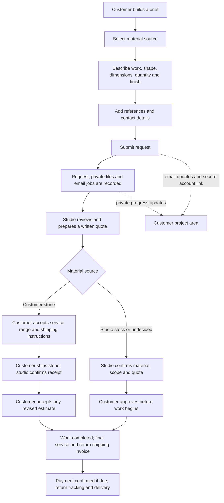

# Lapidary custom order audit

**Date:** 26 October 2026
**Scope:** `https://rendivirgo.com/lapidary/custom-order`, the customer-facing wizard, related Lapidary API and data model, the customer project area, admin workflow, and upload/email handling.

## Method and limits

I inspected the first step of the live production page in the browser and traced the workflow through the repository source. The production page showed the five-step brief builder, `Help me choose` selected by default, and the promise that an account and payment are not required to submit a request. I did not enter customer information, submit a request, or access private production order data.

The report assesses the code paths and rendered starting state; it is not a full live transaction or a device-lab accessibility/performance test. The runtime Coolify volume configuration, email provider delivery, and actual behavior on physical phones still need operational verification. No tests were run.

## Executive summary

The feature has a solid foundation for a bespoke lapidary service: customers can submit as guests, explain their material and desired work, attach private reference files, review an indicative fee, receive email updates, and follow a linked project in their account. The customer-supplied-stone path has notably careful safeguards around estimates, shipping, custody, invoices, and returns. Upload validation, private file handling, an encrypted email outbox, and visible admin retry/readiness controls are also good foundations.

The most important gap is workflow integrity across material sources. The API enforces an explicit status transition map only for `CustomerSupplied` requests. The status field accepts the full enum for other requests, so a stock-material or undecided request does not receive the same server-enforced lifecycle checks. Next, make order submission idempotent, confirm persistent storage and backups for private uploads in Coolify, and improve recovery for guest customers who lose or miss their project link.

There is no confirmed critical security incident in this review. The high-priority items below concern data integrity and operational continuity.

## Current end-to-end flow

The wizard has five steps: material, work, shape and quantity, finish and references, then contact and review. It starts with `Undecided` / “Help me choose.” Work currently offered to a new customer is Pendant, Matched Pairs, and Other. The database/API contain additional legacy service types, which the current frontend does not expose as selectable work.

For customer-supplied material, the customer must describe the stone, provide its approximate weight, and upload at least one photo or video. The studio approval path requires a service estimate range and shipping instructions; the customer accepts the range and enters inbound shipping details before sending the material. The studio confirms receipt before work. At completion, the final service fee cannot exceed the accepted maximum without a revised estimate; return shipping is itemized separately. Payment and return steps are gated before the return is marked delivered.

For studio-stock material, the customer chooses published Rough or Slab inventory and enters the amount needed. The API rechecks product publication and current availability when creating the request. The selection does not reserve stock, so the studio must reconfirm availability before promising it.

An account is optional at intake. A verified, signed-in customer is linked automatically when the request email matches the account email. A guest receives a secure link and can create or sign in to a verified account with the same email. The link is single-use and expires after 30 days. Email notifications continue alongside the account project view.

## Findings and recommendations

### 1. Apply a complete, source-aware status state machine — high priority

**Evidence:** `UpdateLapidaryRequestDto` accepts any `LapidaryRequestStatus` enum value ([DTO](../../api/src/lapidary/lapidary.dto.ts#L152-L164)). In `updateRequest`, the explicit `allowed` transition map is inside `if (customerMaterial)`, so it protects customer-supplied stones only ([service](../../api/src/lapidary/lapidary.service.ts#L1229-L1252)). Other request sources can be submitted with a status value from the full enum, while that transition map is skipped.

**Risk:** an admin workflow mistake, stale UI, or future code path can move a studio-stock or undecided request into a stage that does not match the work actually done. This can mislead staff/customers and trigger inappropriate status emails or downstream actions.

**Recommendation:** define an explicit server-side transition graph for each material source (or one shared graph with source-specific prerequisites). Add rules for quote approval, material confirmation/reservation, work start/completion, invoice, payment, shipment, and terminal states. Validate every transition atomically against the current status. The existing admin audit entry records the resulting status and quote amount; extend it to include the previous status and transition reason so staff can reconstruct how a request moved. Make the admin UI offer only valid next actions, while keeping the API as the source of truth.

### 2. Make request submission idempotent — high priority

**Evidence:** the browser sends a plain `POST /api/lapidary/requests`, then displays a retry message when the connection fails ([form](../../components/lapidary/custom-order-form.tsx#L429-L479)). The controller has rate limiting but no submission idempotency key ([controller](../../api/src/lapidary/lapidary.controller.ts#L47-L90)). The database stores each accepted request in a transaction and gives it a unique request number, but there is no request-level dedupe key in the request model ([service](../../api/src/lapidary/lapidary.service.ts#L576-L664), [schema](../../api/prisma/schema.prisma#L1026-L1083)).

**Risk:** if the server commits a request but the response is lost, a customer who retries can create a second request and duplicate studio/email work. A 5-per-minute throttle limits volume but does not prevent this normal network failure case.

**Recommendation:** generate a random submission key when the draft begins, retain it through retry, and enforce a unique key in the database. Return the existing request number when the same key is replayed. Expire unused keys and avoid deriving them from email, phone, or project content.

### 3. Verify persistent private-file storage and recovery in Coolify — high priority operational check

**Evidence:** uploaded references are type/signature checked, limited to five files, six megabytes each and thirty megabytes total, written under a private directory with restrictive permissions, and served with `private, no-store`, `nosniff`, and a restrictive CSP ([service](../../api/src/lapidary/lapidary.service.ts#L705-L750), [controller](../../api/src/lapidary/lapidary.controller.ts#L112-L123)). The Docker image sets `/data/private/lapidary` and declares `/data/private` as a volume ([Dockerfile](../../api/Dockerfile#L30-L47)).

**Risk:** stone photos, progress images, payment evidence, and associated request records are operationally important. A Docker volume declaration alone does not establish that the deployed Coolify service has the expected durable mount, backups, or a tested restore path. I could not inspect the live Coolify configuration in this audit.

**Recommendation:** verify that Coolify mounts a persistent volume to `/data/private`, that the API process can read/write it after redeploy, and that scheduled backups cover it. Test restore to a staging deployment and confirm private routes still authorize correctly. Define retention/deletion rules for uploads and payment evidence, including how records are handled when a customer requests deletion.

### 4. Add a guest self-service link recovery path — medium priority

**Evidence:** guest claim tokens are stored as hashes, expire after 30 days, require a verified account with the matching email, and are consumed atomically ([service](../../api/src/lapidary/lapidary.service.ts#L893-L914)). Admins can issue a replacement link, with throttling, and the email states that it replaces earlier invitations ([service](../../api/src/lapidary/lapidary.service.ts#L1090-L1115)). The customer empty state tells a guest to find the secure link in email ([customer page](../../components/customer-lapidary.tsx#L246)).

**Risk:** if the invitation email is missed, expires, or goes to spam, customer recovery depends on contacting the studio. This is safe but creates avoidable support work and can block progress visibility.

**Recommendation:** offer “Resend project access” from sign-in or help. Ask for the request email and request number if available; always return a generic response, rate-limit by account/IP, require email verification before issuing a new token, audit the action, and invalidate prior links. Preserve the same-email and single-use checks.

### 5. Separate service-pricing failure from “not priced” — medium priority

**Evidence:** the public pricing fetch silently ignores failure or invalid data and leaves `servicePricingReady` false ([form](../../components/lapidary/custom-order-form.tsx#L97-L110)). A pendant/pair then appears as “Service fee estimate unavailable”; Other is intentionally quoted after review ([form](../../components/lapidary/custom-order-form.tsx#L301-L305), [review](../../components/lapidary/custom-order-form.tsx#L770-L780)).

**Risk:** customers cannot tell whether their service is genuinely custom-priced or the pricing endpoint failed. This makes the price summary less useful and may reduce trust.

**Recommendation:** expose a retryable loading/error state and distinguish “price could not load” from “studio quote required.” Keep the existing non-binding disclaimer and state clearly that material, shipping, and Other work are excluded. Add an admin alert/health metric if pricing config is missing or invalid.

### 6. Protect inventory intent from race conditions — medium priority, depends on business rules

**Evidence:** stock availability is checked by reading the selected product and summing current stock before the request transaction starts ([service](../../api/src/lapidary/lapidary.service.ts#L518-L554)). The page tells customers the studio will recheck availability; it does not reserve the stock.

**Risk:** two requests can both pass the same check for scarce or unique material before either is reviewed. This is not an order/payment reservation, but it can create conflicting expectations if the customer interprets the selection as secured.

**Recommendation:** decide whether a selection is a preference or a hold. If it is only a preference, repeat the availability check at quote/approval and make the reconfirmation prominent in the request and email. If you intend to promise the material, add an expiring, transactional inventory hold released on decline, expiry, or cancellation. Do not reserve at initial browsing without clear timing and release rules.

### 7. Strengthen consent and privacy traceability — medium priority

**Evidence:** the customer must check a consent statement that this is an assessment/quote request and no work or payment is confirmed; the API validates consent. The request row stores `termsAcceptedAt`, but the schema has no consent-text version/hash field ([form](../../components/lapidary/custom-order-form.tsx#L788-L799), [schema](../../api/prisma/schema.prisma#L1026-L1065)). The form says contact details and uploaded references are shared with the studio team.

**Risk:** if terms or privacy wording changes, a timestamp alone does not identify which text a customer accepted. Customers also need clear expectations for file retention, email processing, account invitations, and how to request removal.

**Recommendation:** store a consent/terms version (or immutable content hash) with the accepted timestamp. Link a concise privacy notice at intake that explains purpose, access, third-party email processing, retention, and deletion/contact route. Avoid storing more sensitive material than the studio needs.

### 8. Make the 3D step lighter and validate reachability on real phones — medium priority

**Evidence:** the preview dynamically imports `model-viewer`, provides a poster fallback and retry, and currently asks the 3D element to load eagerly ([preview](../../components/lapidary/oval-cabochon-preview.tsx#L50-L57), [model](../../components/lapidary/oval-cabochon-preview.tsx#L116-L144)). The mobile stylesheet sets 44-pixel controls and dome inputs, a sticky Continue bar, safe-area padding, and moves the actions back into flow while text inputs are focused or on short viewports ([CSS](../../app/(storefront)/lapidary/lapidary.css#L870-L919)).

**Risk:** a long shape/3D section still requires scrolling, and eager model loading can be costly on slower mobile networks or devices. Source inspection cannot confirm that dome controls and Continue remain comfortable with the phone keyboard open, browser chrome visible, or screen readers enabled.

**Recommendation:** load the interactive model only after the customer opens the preview; keep the static poster as the default and offer a lightweight mode. On actual iOS and Android devices, verify that dome profile, height, quantity, and Continue are reachable without losing context at 320/360/390-pixel widths and short heights. Test keyboard, zoom, screen reader labels, focus after each step, and safe-area behavior. WCAG 2.2 AA sets a 24×24 CSS-pixel minimum for pointer targets subject to exceptions; the current 44-pixel controls exceed that size where those rules apply, but the whole page still needs a real interaction audit. [W3C target-size guidance](https://www.w3.org/WAI/WCAG22/Understanding/target-size-minimum)

### 9. Clarify supported work before adding more service types — product decision

**Evidence:** the current customer form exposes Pendant, Matched Pairs, and Other ([choices](../../components/lapidary/custom-order-form.tsx#L49-L53)), while the schema retains additional service types such as faceting, freeform, slab polishing, and decorations ([schema](../../api/prisma/schema.prisma#L234-L250)).

**Risk:** customers who expect those services may not know whether “Other” is suitable, while exposing more types without service-specific requirements, pricing, and milestones can create ambiguous requests.

**Recommendation:** confirm the services the studio accepts now. Keep the current narrow set if it reflects capacity, but describe what “Other” should include and what happens next. Add a service type only with its required inputs, quote policy, timeline, inventory/material rules, and status path defined end to end.

### 10. Improve confirmation and customer-facing progress clarity — medium priority

**Evidence:** success shows the request number and says the studio will review it; it also distinguishes linked customers from guests ([form](../../components/lapidary/custom-order-form.tsx#L583-L595)). Email delivery runs through a durable outbox with retries and a terminal admin notification ([outbox](../../api/src/lapidary/lapidary-email-outbox.service.ts#L91-L140)). Admin UI correctly says provider acceptance does not confirm inbox delivery ([admin page](../../app/admin/(dashboard)/lapidary/requests/page.tsx#L231)).

**Risk:** the guest confirmation says a secure link will be emailed, but the customer cannot see whether the invitation is queued, delivered to the provider, or failed. If email is delayed, their next action is unclear.

**Recommendation:** keep the request confirmation as “received” and avoid promising inbox delivery. Add copyable request number, a clear “check spam / request a new link” path, and a support contact. In the customer account, make the next required action, its deadline, and who is responsible obvious for each status. Preserve admin visibility of queued, failed, and retryable messages.

### 11. Keep the form consistent with the English-only site preference — medium priority

**Evidence:** the public page rendered in English during this audit, but the form source still branches on `language === "id"` and contains Indonesian labels, help text, validation, and consent copy throughout ([form examples](../../components/lapidary/custom-order-form.tsx#L41-L53), [material choices](../../components/lapidary/custom-order-form.tsx#L622-L625), [consent](../../components/lapidary/custom-order-form.tsx#L788-L799)).

**Risk:** the feature can still show mixed or Indonesian copy when the site language state is Indonesian, which conflicts with the previously stated English-only site preference and can make review, consent, and support instructions inconsistent.

**Recommendation:** if English-only remains the intended policy, remove the Indonesian branches from this feature and ensure the public route always uses English for visible UI, validation errors, emails, and account instructions. Keep saved customer-provided material descriptions intact; this recommendation is about interface copy.

## Existing strengths to preserve

- Five focused steps with a clear progress indicator, draft saving in the current browser tab, and a clear-draft action. The draft excludes contact details and uploaded file contents; customers must reattach files after reload.
- Frontend and backend validation for required stone details, dimensions, custom shape descriptions, quantity, date, material source, and uploaded media.
- Uploads are limited in count and size, MIME is checked against file signatures for image types and MP4 container markers, stored under restrictive filesystem permissions, and served through private routes. These controls align with OWASP guidance to allowlist file types, validate signatures, limit size, and store uploads outside public web access. [OWASP File Upload Cheat Sheet](https://cheatsheetseries.owasp.org/cheatsheets/File_Upload_Cheat_Sheet.html)
- Guest access is optional, based on a high-entropy token stored as a hash, email match, verified account, one-time claim, and expiry.
- Customer-supplied stone handling protects physical custody: shipping instructions, inbound tracking, receipt confirmation, estimate acceptance, maximum fee, final invoice, payment confirmation, and return tracking are represented in the workflow.
- Email jobs are enqueued transactionally with the request, encrypted at rest in the outbox, deduplicated per message, retried, and surfaced to admins when retries are exhausted.
- Customer progress API only returns updates marked customer-visible, and customer media routes require customer ownership.
- The mobile CSS already anticipates thumb-friendly controls, sticky actions, safe-area insets, focused inputs, short viewports, reduced motion, and a poster fallback for a failed 3D load.

## Recommended delivery order

### Immediate

1. Add source-aware server transition maps and prerequisite checks for every status.
2. Verify the production volume mount at `/data/private`, backups, and a restore procedure in Coolify.
3. Add request idempotency so a network retry cannot create duplicate projects.

### Next iteration

4. Add a secure customer self-service resend/recovery flow for expired or missing project links.
5. Make pricing-load errors explicit and retryable; confirm selected stock again at approval.
6. Record the consent/terms version and publish retention/deletion expectations for private uploads.
7. Validate the current mobile wizard on real devices and defer 3D loading until it is requested.
8. Remove remaining Indonesian UI branches if the English-only site policy is still in effect.

### Product development

9. Define a service catalog with matching input requirements, pricing rules, and status graph before expanding beyond the three current choices.
10. Add operational reporting for time-to-first-review, quote acceptance, material-in-transit/received delays, email failures, cancellations, and return completion. Use these metrics to identify where customers get stuck before adding automation.

## Files reviewed

- `components/lapidary/custom-order-form.tsx`
- `components/lapidary/oval-cabochon-preview.tsx`
- `app/(storefront)/lapidary/lapidary.css`
- `api/src/lapidary/lapidary.controller.ts`
- `api/src/lapidary/lapidary.dto.ts`
- `api/src/lapidary/lapidary.service.ts`
- `api/src/lapidary/lapidary-email-outbox.service.ts`
- `components/customer-lapidary.tsx`
- `app/admin/(dashboard)/lapidary/requests/page.tsx`
- `api/prisma/schema.prisma`
- `api/Dockerfile`
