# Alur End-to-End Order RENDI VIRGO

Diagram ini menunjukkan alur Retail guest/customer, Wholesale untuk customer nasional maupun internasional yang disetujui admin, dan POS Workshop. Ketiga channel memakai satu stok fisik bersama. Reservasi aktif—termasuk reservasi POS sementara—mengurangi stok yang tersedia untuk semua channel.

```mermaid
flowchart TB
    accTitle: Alur End-to-End Retail, Wholesale, dan POS RENDI VIRGO
    accDescr: Retail dapat checkout sebagai guest atau customer. Wholesale memerlukan account terverifikasi dan izin admin serta mendukung tujuan nasional dan internasional yang dilayani konfigurasi checkout. Checkout online menampilkan quote, memvalidasi ulang aturan dan mereservasi stok. POS menahan stok sebelum pembayaran dan mengurangi stok fisik setelah pembayaran berhasil. Semua channel memakai satu pool stok.

    subgraph retail_lane["Retail Order — Website Publik"]
        direction LR
        retail_start([Mulai]) --> retail_catalog["Katalog publik<br/>Channel Retail aktif<br/>Harga Retail"]
        retail_catalog --> retail_cart["Keranjang Retail"]
        retail_cart --> retail_checkout["Checkout sebagai guest atau login<br/>Alamat, ongkir, dan pembayaran"]
    end

    subgraph wholesale_lane["Wholesale Order — Dashboard Privat"]
        direction LR
        wholesale_account["Daftar/login Customer account yang sama<br/>Verifikasi email"] --> wholesale_access{"Izin Wholesale aktif?"}
        wholesale_access -->|Belum| wholesale_wait["Akses katalog dan order tertutup<br/>Admin meninjau profil terverifikasi<br/>dan memberi akses manual"]
        wholesale_admin["Admin memberi izin<br/>tanpa formulir aplikasi publik"] -.-> wholesale_access
        wholesale_access -->|Ya| wholesale_catalog["Katalog privat<br/>Channel Wholesale aktif<br/>Harga Wholesale"]
        wholesale_catalog --> wholesale_cart["Keranjang Wholesale<br/>Minimum US$300 subtotal barang<br/>ATAU 100 pcs ekuivalen"]
        wholesale_cart --> wholesale_checkout["Checkout langsung<br/>Alamat domestik/internasional<br/>sesuai layanan tersedia"]
        wholesale_catalog -.-> wholesale_visibility["Jika Retail juga aktif: publik melihat harga Retail;<br/>harga Wholesale tetap privat"]
    end

    subgraph online_flow["Checkout Online Bersama — Retail dan Wholesale"]
        direction LR
        online_quote["Server hitung quote<br/>Harga, ongkir, pajak, total"]
        online_approve{"Customer menyetujui<br/>quote final?"}
        online_validate["Server validasi final<br/>Akses/customer, channel, harga<br/>Alamat/layanan, MOQ pcs, pembayaran"]
        online_rules{"Semua aturan<br/>terpenuhi?"}
        online_stock{"Stok tersedia<br/>untuk direservasi?"}
        online_update["Tampilkan perubahan/aturan yang gagal<br/>Perbarui keranjang atau setujui quote baru"]
        online_create["Buat Order + reservasi stok<br/>secara atomik<br/>Source: Online/Retail atau Wholesale<br/>Order: New • Payment: Pending"]
        online_payment{"Metode pembayaran?"}
        paypal["PayPal capture"]
        online_retry["PayPal gagal<br/>Customer boleh mencoba lagi"]
        bank_transfer["Transfer bank<br/>Customer unggah bukti"]
        admin_verify{"Admin memverifikasi<br/>bukti transfer?"}
        proof_retry["Customer menerima alasan<br/>dan dapat unggah ulang sebelum batas waktu"]
        online_wait["Pembayaran masih Pending<br/>menunggu pembayaran atau verifikasi"]
        online_paid["Payment: Paid<br/>Callback diproses idempoten"]
        online_expiry{"Batas pembayaran<br/>terlewati?"}
        online_cancel["Order Cancelled<br/>Payment: Failed<br/>Lepaskan reservasi stok"]
        late_payment["Pembayaran terlambat masuk<br/>Antrean rekonsiliasi/refund admin<br/>Order tidak dibuka otomatis"]
        online_fulfill["Hanya setelah Payment: Paid<br/>Processing → Packed → Shipped → Completed"]

        online_quote --> online_approve
        online_approve -->|Ya| online_validate
        online_approve -->|Tidak| online_update
        online_update --> online_quote
        online_validate --> online_rules
        online_rules -->|Tidak| online_update
        online_rules -->|Ya| online_stock
        online_stock -->|Tidak| online_update
        online_stock -->|Ya| online_create
        online_create --> online_payment
        online_payment -->|PayPal| paypal
        online_payment -->|Transfer bank| bank_transfer
        paypal -->|Berhasil| online_paid
        paypal -->|Gagal| online_retry
        paypal -->|Masih diproses| online_wait
        online_retry --> online_payment
        bank_transfer --> admin_verify
        admin_verify -->|Valid| online_paid
        admin_verify -->|Ditolak| proof_retry
        admin_verify -->|Menunggu| online_wait
        proof_retry -->|Unggah ulang| admin_verify
        proof_retry --> online_wait
        online_wait --> online_expiry
        online_expiry -->|Belum| online_wait
        online_expiry -->|Ya| online_cancel
        online_cancel -. pembayaran terlambat .-> late_payment
        online_paid --> online_fulfill
    end

    subgraph pos_lane["POS Workshop — Dashboard Admin"]
        direction LR
        pos_admin["Admin login"] --> pos_catalog["Cari produk<br/>Channel POS Workshop aktif"]
        pos_catalog --> pos_cart["Pilih produk dan jumlah<br/>Customer opsional<br/>Harga USD dikonversi ke IDR"]
        pos_cart --> pos_adjust["Sesuaikan harga atau diskon<br/>Alasan diskon wajib"]
        pos_adjust --> pos_validate["Server cek channel, harga,<br/>diskon, dan stok terkini"]
        pos_validate --> pos_available{"Stok tersedia?"}
        pos_available -->|Tidak| pos_refresh["Jangan mulai pembayaran<br/>Perbarui keranjang"]
        pos_refresh --> pos_cart
        pos_available -->|Ya| pos_hold["Reservasi POS sementara<br/>secara atomik sebelum pembayaran"]
        pos_hold --> pos_payment["Tunai, Transfer, atau QRIS<br/>Admin konfirmasi dana diterima"]
        pos_payment --> pos_result{"Pembayaran lunas<br/>sebelum reservasi habis?"}
        pos_result -->|Ya| pos_complete["Buat Order POS + kurangi stok fisik<br/>+ lepaskan reservasi secara atomik<br/>IDR • Paid • Completed"]
        pos_result -->|Gagal/batal/kedaluwarsa| pos_release["Lepaskan reservasi POS<br/>Jika dana masuk terlambat: rekonsiliasi admin"]
        pos_complete --> pos_receipt["Cetak struk<br/>Serahkan barang di Workshop"]
    end

    subgraph shared_records["Stok dan Catatan Bersama"]
        direction LR
        shared_stock[("Satu stok fisik bersama<br/>Retail • Wholesale • POS")]
        available_stock["Stok tersedia = stok fisik<br/>− seluruh reservasi aktif"]
        order_records[("Order + snapshot harga/item/alamat<br/>Source Online/Retail • Wholesale • POS")]
        order_views["Laporan dan daftar order Admin<br/>Riwayat Customer untuk order tertaut"]
        guest_link["Guest dapat membuat account setelah membeli;<br/>verifikasi email menautkan order lama;<br/>order baru masuk setelah customer login"]
        shared_stock --> available_stock
        order_records --> order_views
    end

    retail_checkout --> online_quote
    wholesale_checkout --> online_quote
    online_create -. reservasi checkout online .-> shared_stock
    online_cancel -. lepaskan reservasi online .-> shared_stock
    pos_available -. cek stok setelah reservasi online .-> available_stock
    pos_hold -. reservasi sementara POS .-> shared_stock
    pos_release -. lepaskan reservasi POS .-> shared_stock
    pos_complete -. kurangi stok fisik dan tutup reservasi .-> shared_stock
    online_create --> order_records
    pos_complete --> order_records
    online_create -. guest order tertaut setelah verifikasi/login .-> guest_link

    classDef action fill:#dbeafe,stroke:#2563eb,stroke-width:1.5px,color:#1e3a5f
    classDef decision fill:#fef9c3,stroke:#ca8a04,stroke-width:1.5px,color:#713f12
    classDef success fill:#dcfce7,stroke:#16a34a,stroke-width:1.5px,color:#14532d
    classDef exception fill:#fee2e2,stroke:#dc2626,stroke-width:1.5px,color:#7f1d1d
    classDef shared fill:#ede9fe,stroke:#7c3aed,stroke-width:1.5px,color:#3b0764

    class retail_start,retail_catalog,retail_cart,retail_checkout,wholesale_account,wholesale_wait,wholesale_admin,wholesale_catalog,wholesale_cart,wholesale_checkout,wholesale_visibility,online_quote,online_validate,online_update,online_create,paypal,online_retry,bank_transfer,proof_retry,online_wait,online_fulfill,pos_admin,pos_catalog,pos_cart,pos_adjust,pos_validate,pos_refresh,pos_hold,pos_payment,pos_release,pos_receipt,guest_link action
    class wholesale_access,online_approve,online_rules,online_stock,online_payment,admin_verify,online_expiry,pos_available,pos_result decision
    class online_paid,pos_complete success
    class online_cancel,late_payment exception
    class shared_stock,available_stock,order_records,order_views shared
```

## Catatan kebijakan

- Minimum Wholesale adalah US$300 subtotal barang atau 100 pcs ekuivalen; hitungan subtotal tidak mencakup ongkir, pajak, dan diskon. Kupon/promosi Retail tidak berlaku pada Wholesale MVP.
- Order yang belum lunas tidak dapat berlanjut ke fulfillment. Expiry sweep mencakup status New, Processing, dan Packed; order yang kedaluwarsa ditandai Cancelled/Failed dan stok reservasi dilepas.
- Membatalkan order Paid atau PartiallyRefunded mensyaratkan pencatatan refund penuh. Order Returned tidak otomatis menambah stok; admin memeriksa kondisi lalu menjalankan restock satu kali.
- Produk dengan stok Unique tidak boleh memiliki varian. Produk Unique berkonfigurasi varian dikecualikan dari katalog Wholesale dan ditolak saat checkout.
- Wholesale melayani alamat domestik dan internasional selama konfigurasi pengiriman/pembayaran mendukung tujuan tersebut.
- Channel produk menentukan tempat penjualan, bukan alokasi stok. POS, Retail, dan Wholesale mengurangi satu stok fisik bersama.
- Implementasi POS menahan stok bersama selama lima menit sebelum admin mengonfirmasi pembayaran penuh. Admin dapat memperpanjang atau melepas reservasi; hold kedaluwarsa dilepas server.
- Migrasi yang menyatukan alokasi Workshop lama dengan stok utama perlu diterapkan sebelum menjalankan kode pada database.
