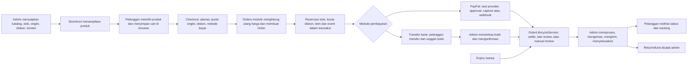

# RENDI VIRGO — Workflow review dan rekomendasi

**Tanggal:** 16 Oktober 2026  
**Cakupan:** alur pelanggan dan admin yang terlihat dari source storefront Next.js, API NestJS, dan model Prisma.  
**Metode:** pembacaan statis source dan pemetaan caller ke penyimpanan/efek. Tidak menjalankan aplikasi, database, atau integrasi PayPal.

## Ringkasan

Alur e-commerce RENDI VIRGO sudah mencakup penemuan produk, cart, checkout, pembayaran, fulfillment, pelacakan, dan administrasi katalog. Perubahan terbaru juga sudah menempatkan aturan status, reservasi stok/diskon, settlement, expiry, dan refund di satu `OrderLifecycleService`. Itu memberi satu seam yang lebih jelas untuk aturan Order.

Prioritas berikutnya ada pada keandalan saat callback pembayaran diulang, pemulihan efek setelah commit, dan kesepakatan harga antara tampilan checkout dan Order yang disimpan. Ada pula celah operasional di antrean bukti transfer dan pengajuan retur pelanggan.

## Peta workflow saat ini

### Ringkasan per tahap

1. **Merchandising:** admin mengelola produk, kategori, stok, harga, diskon, pengiriman, serta halaman/blog/banner. Route admin dilindungi `AdminGuard`; perubahan admin umumnya mengirim konteks ke `AuditService`.
2. **Penemuan dan cart:** katalog publik dibaca dari API dan dipetakan ke bentuk storefront. Cart disimpan di `localStorage`, sehingga isi cart dapat bertahan setelah halaman ditutup.
3. **Checkout dan reservasi:** browser menampilkan quote ongkir/diskon, lalu mengirim ID barang, jumlah, kode diskon, dan pilihan ongkir. Server membaca ulang katalog dan menghitung Order, lalu membuat Order bersama reservasi stok dan slot diskon.
4. **Pembayaran:** PayPal memakai sesi provider yang diverifikasi melalui capture/webhook. Transfer bank meminta bukti gambar, lalu menunggu konfirmasi admin. Expiry sweep melepaskan reservasi yang belum dibayar sesuai payment window.
5. **Fulfillment dan pascapenjualan:** admin mengubah graf status dan memasukkan tracking. Pelanggan dapat meminta tautan riwayat lewat email atau mencari tracking dengan nomor Order dan email. Refund saat ini adalah pencatatan admin, bukan pemanggilan provider.
6. **Alur pendukung:** contact message masuk ke inbox admin, review menunggu moderasi, dan newsletter menyimpan subscription. Tidak terlihat proses retur mandiri pelanggan; perubahan status Returned dimulai dari admin.

## Temuan dan rekomendasi

### 1. P1 — Identitas sesi PayPal hilang setelah settlement

Order menyimpan satu `paymentRef`. Saat sesi dibuat, field itu menyimpan ID Order PayPal; saat settlement, field yang sama ditimpa dengan ID capture. Endpoint callback checkout mencari Order hanya berdasarkan `paymentRef` yang diterima dari PayPal. Karena callback browser mengirim kembali ID sesi, callback ulang setelah settlement dapat gagal menemukan Order sebelum mencapai logika settlement idempotent.

**Dampak:** pemulihan halaman PayPal bisa menampilkan kegagalan walau pembayaran sudah tercatat Paid. Perilaku duplicate settlement aman di dalam lifecycle, tetapi lookup caller dapat menghalangi jalur retry itu.

**Rekomendasi:** simpan ID sesi PayPal dan ID capture sebagai identitas terpisah—atau sebagai payment attempt—serta pertahankan relasi unik ke Order. Pastikan callback berulang dapat menemukan Order dan mengembalikan status Paid/review yang sudah ada tanpa menulis ulang pembayaran.

**Bukti:** [Order.paymentRef](/Users/drefan/Projects/RENDI%20VIRGO/api/prisma/schema.prisma:387), [sesi PayPal disimpan](/Users/drefan/Projects/RENDI%20VIRGO/api/src/orders/order-lifecycle.service.ts:557), [lookup callback](/Users/drefan/Projects/RENDI%20VIRGO/api/src/payments/payments.service.ts:293), [settlement mengganti referensi](/Users/drefan/Projects/RENDI%20VIRGO/api/src/orders/order-lifecycle.service.ts:461), [callback browser](/Users/drefan/Projects/RENDI%20VIRGO/components/checkout-view.tsx:424).

### 2. P1 — Efek setelah commit tidak punya jalur retry yang tahan gagal

Order dan settlement tersimpan sebelum notification/email dikirim. Jika pengiriman efek setelah commit gagal, database sudah berubah. Retry checkout dengan `checkoutKey` mengembalikan Order yang ada tanpa mengulang notifikasi Order baru. Retry webhook pembayaran akan dianggap duplicate dan tidak memanggil lagi `notifyPaymentReceived`.

**Dampak:** Order atau pembayaran bisa benar di database, tetapi email pelanggan/admin atau notifikasi internal hilang. Respons HTTP yang gagal juga dapat membuat pelanggan mengira pesanan gagal dibuat.

**Rekomendasi:** tulis event/outbox pengiriman dalam transaksi yang sama dengan perubahan Order. Worker pascacommit mengirim email/notifikasi dengan retry dan deduplikasi. Pertahankan template dan aturan pengiriman yang ada.

**Bukti:** [side effect setelah create](/Users/drefan/Projects/RENDI%20VIRGO/api/src/orders/orders.service.ts:506), [retry checkout mengembalikan Order lama](/Users/drefan/Projects/RENDI%20VIRGO/api/src/orders/orders.service.ts:341), [settlement memanggil efek hanya untuk hasil baru](/Users/drefan/Projects/RENDI%20VIRGO/api/src/orders/order-lifecycle.service.ts:516), [email dan notification settlement](/Users/drefan/Projects/RENDI%20VIRGO/api/src/orders/order-lifecycle.service.ts:850).

### 3. P2 — Checkout tidak meminta persetujuan ulang jika jumlah server berbeda dari preview

Browser menghitung tampilan subtotal/ongkir/diskon dari data cart dan quote yang dimuat sebelumnya. Server menghitung ulang harga katalog, ongkir, diskon, serta total ketika Order dibuat. Setelah menerima `payload.total`, browser langsung menghapus cart dan meneruskan pembayaran tanpa membandingkan total itu dengan angka yang terakhir ditampilkan.

**Dampak:** perubahan harga, ketersediaan rate, atau diskon saat pelanggan sedang checkout dapat menghasilkan total Order berbeda dari preview yang mereka setujui.

**Rekomendasi:** sediakan quote final dari server yang memuat item, harga, ongkir, diskon, total, dan masa berlaku. Tampilkan perubahan total kepada pelanggan dan minta persetujuan sebelum membuat reservasi Order atau mengarahkan ke pembayaran.

**Bukti:** [browser mengirim ID/qty dan memilih quote](/Users/drefan/Projects/RENDI%20VIRGO/components/checkout-view.tsx:603), [server menghitung ulang dan membentuk snapshot](/Users/drefan/Projects/RENDI%20VIRGO/api/src/orders/orders.service.ts:369), [browser memakai total balasan tanpa rekonsiliasi](/Users/drefan/Projects/RENDI%20VIRGO/components/checkout-view.tsx:649).

### 4. P2 — Pemulihan checkout tidak membedakan Order pending yang terminal

`resumeCheckout` membaca payment status dan metode, tetapi tidak membaca status Order. Untuk Order `Cancelled + Pending` atau `Returned + Pending`, pemulihan dapat menghasilkan hasil `recovered`; UI menampilkan tombol coba bayar lagi. Endpoint pembuatan sesi PayPal kemudian menolak Order terminal.

**Dampak:** pelanggan melihat tombol yang tidak dapat menyelesaikan pembayaran dan baru mengetahui masalah setelah menekan tombol.

**Rekomendasi:** sertakan status Order dan keputusan retry dari server dalam hasil resume. UI menampilkan instruksi manual review atau kontak admin untuk Order terminal, dan hanya menawarkan retry saat Order benar-benar masih aktif.

**Bukti:** [resume tidak memilih/mengembalikan status Order](/Users/drefan/Projects/RENDI%20VIRGO/api/src/payments/payments.service.ts:82), [tombol retry dibentuk dari notice, bukan status Order](/Users/drefan/Projects/RENDI%20VIRGO/components/checkout-view.tsx:737), [sesi ditolak untuk status terminal](/Users/drefan/Projects/RENDI%20VIRGO/api/src/payments/payments.service.ts:243).

### 5. P2 — Bukti transfer yang sudah diunggah menahan reservasi tanpa batas waktu

Payment window transfer bank berhenti kedaluwarsa setelah bukti transfer diunggah. Expiry sweep hanya memilih Order transfer bank tanpa bukti. Ini melindungi pelanggan yang sudah membayar, tetapi Order dapat menahan stok sampai admin memeriksanya.

**Dampak:** stok terbatas—terutama barang unik—bisa lama tidak tersedia jika bukti belum ditinjau.

**Rekomendasi:** buat antrean admin khusus “bukti transfer menunggu verifikasi” dengan umur bukti, pengurutan paling lama, dan indikator SLA. Setelah metrik operasional tersedia, tentukan kebijakan eskalasi/pelepasan secara eksplisit; jangan mengubah expiry otomatis tanpa keputusan bisnis.

**Bukti:** [bukti membuat payment window tidak kedaluwarsa](/Users/drefan/Projects/RENDI%20VIRGO/api/src/orders/order-lifecycle.service.ts:115), [expiry sweep hanya memilih Order tanpa bukti](/Users/drefan/Projects/RENDI%20VIRGO/api/src/orders/order-lifecycle.service.ts:709).

### 6. P2 — Retur tidak memiliki intake pelanggan; refund adalah pencatatan saja

Route perubahan ke Returned dan Refund hanya tersedia di admin. Alur publik yang terlihat menyediakan tracking, riwayat, dan kontak umum. Refund menambah `refundedAmount` dan mengubah payment status, tanpa integrasi transfer uang ke PayPal/bank.

**Dampak:** pelanggan perlu memakai kanal kontak umum untuk memulai retur, sementara operator harus membedakan refund yang dicatat dari dana yang benar-benar dikirim.

**Rekomendasi:** buat intake retur terstruktur yang terkait Order dan meminta alasan/bukti; sediakan status review untuk admin. Pada halaman refund, jelaskan bahwa tindakan tersebut mencatat refund saja dan sediakan field referensi/konfirmasi transfer bila refund dikirim di luar sistem.

**Bukti:** [route publik dan route admin Order](/Users/drefan/Projects/RENDI%20VIRGO/api/src/orders/orders.controller.ts:22), [refund pada admin route](/Users/drefan/Projects/RENDI%20VIRGO/api/src/orders/orders.controller.ts:108), [refund hanya pencatatan Order](/Users/drefan/Projects/RENDI%20VIRGO/api/src/orders/order-lifecycle.service.ts:659).

### 7. P3 — Recovery checkout bercampur dengan state dan rendering form

`CheckoutView` berisi input, quote ongkir, validasi diskon, penyimpanan draft, pemulihan attempt, PayPal return/capture, unggah bukti, dan tampilan hasil dalam satu file sekitar 1.058 baris.

**Rekomendasi:** setelah isu payment-reference dan resume diperbaiki, dalami satu module pemulihan checkout dengan interface kecil untuk membaca attempt, memulihkan Order, dan membersihkan draft. Biarkan form tetap mengatur tampilan; jangan memecah file hanya berdasarkan ukuran.

**Bukti:** [CheckoutView](/Users/drefan/Projects/RENDI%20VIRGO/components/checkout-view.tsx:241), [recovery dan resume](/Users/drefan/Projects/RENDI%20VIRGO/components/checkout-view.tsx:474), [checkout dan payment result](/Users/drefan/Projects/RENDI%20VIRGO/components/checkout-view.tsx:603).

## Rekomendasi urutan kerja

1. Pisahkan identitas sesi/capture PayPal dan pulihkan callback retry.
2. Tambahkan outbox untuk email/notifikasi Order dan settlement agar efek pascacommit dapat dicoba ulang.
3. Buat quote final server dan persetujuan ulang saat total berubah.
4. Tambahkan resume berbasis status Order serta antrean bukti transfer dengan umur/SLA.
5. Rancang intake retur pelanggan dan bedakan refund record dari pengiriman dana.
6. Setelah alur kritis stabil, pisahkan module recovery checkout untuk memperbaiki locality dan memudahkan pengujian.

## Bagian yang sudah memiliki fondasi baik

- Server menghitung ulang harga dari katalog dan menolak checkout ketika stok atau slot diskon tidak dapat diamankan.
- Checkout memakai `checkoutKey` dan fingerprint untuk menghindari Order ganda ketika request diulang.
- Status Order, settlement, stok, diskon, expiry, event, dan manual review kini berkumpul pada satu seam lifecycle.
- Graf fulfillment eksplisit; tracking, riwayat berlink-token, proof transfer, dan audit admin tersedia.
- Route admin dilindungi guard global, sementara endpoint publik diberi deklarasi eksplisit.

## Batas analisis

Ini adalah analisis source pada working tree per 16 Oktober 2026, bukan validasi runtime. Saya tidak menjalankan test/build, tidak membuat Order sungguhan, dan tidak memanggil PayPal atau layanan pengiriman eksternal. Rekomendasi menilai alur yang terlihat di kode, bukan konfigurasi produksi atau prosedur operasional tim.
